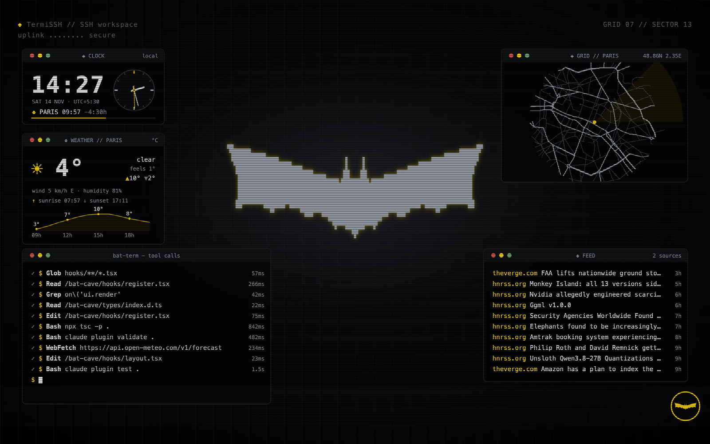
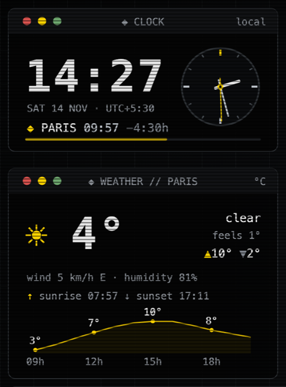
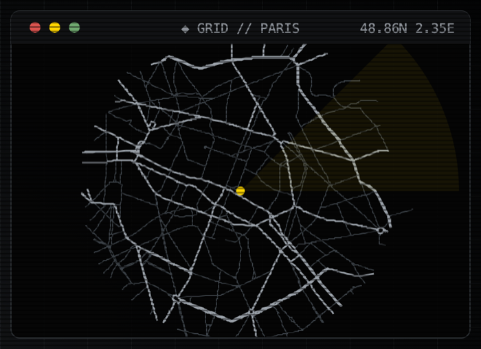
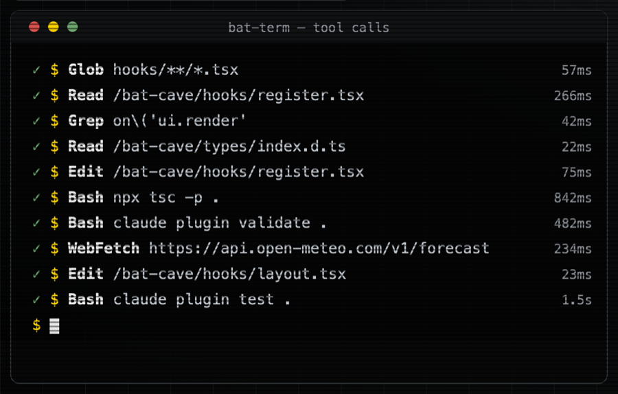
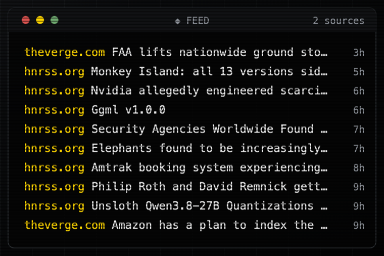
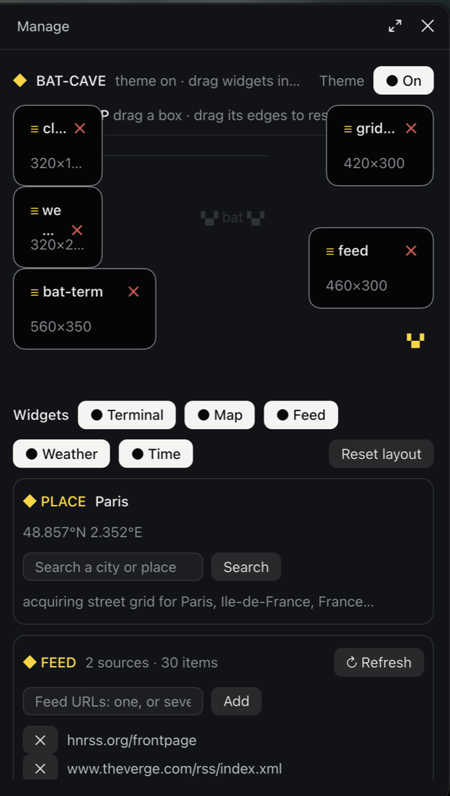
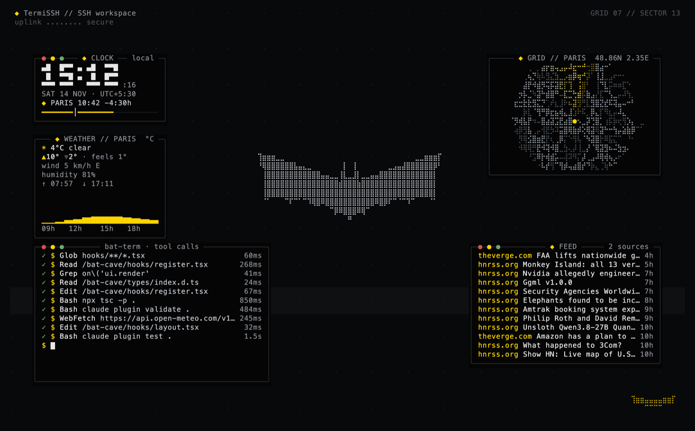

# bat-cave

A dark, terminal-style theme for Claude Code. In the desktop app a block-character bat turns slowly behind your conversation, surrounded by live widgets: a clock, the weather, a street map, a news feed and a terminal that shows Claude's tool calls as they happen. In a terminal you get the same scene as a live dashboard pane.



The colours come from the "Dark Knight" palette of TermiSSH: near-black surfaces, steel greys and a single yellow accent. The bat is an original drawing, not the logo of any film or comic.

## Install

**In the desktop app:** click **+** next to the prompt box, then **Plugins**, then **Add marketplace**, and enter:

```text
Sumit189/bat-cave
```

Then choose **Add plugin** next to bat-cave.

**In a terminal session of Claude Code**, type at the prompt:

```text
/plugin install bat-cave --marketplace Sumit189/bat-cave
```

Answer `y` to add the marketplace, then press Enter to install for your user.

**From a shell:**

```bash
claude plugin install bat-cave --marketplace Sumit189/bat-cave
```

A theme installed from a terminal for your user also loads in the desktop app.

### Then

1. Open a new chat in the desktop app. The backdrop appears behind the conversation straight away.
2. Type `/bat-cave` to open **Manage**.
3. Search a place for the map, weather and clock, and add a feed or two.

### From a local copy

Clone the repository, then point Claude Code at the folder:

```bash
git clone https://github.com/Sumit189/bat-cave.git
```

```bash
claude plugin marketplace add ./bat-cave
```

```bash
claude plugin install bat-cave@bat-cave
```

Or try it for one session without installing:

```bash
claude --plugin-dir ./bat-cave
```

## Widgets

| | |
| --- | --- |
|  |  |
| **Clock.** Your local time with an analog dial and a sweeping seconds hand, the date and your UTC offset, the time at your chosen place and how far ahead or behind it is, and a bar for how much of the day has gone. <br><br> **Weather.** Current conditions at your chosen place: temperature, sky (with a moon at night), feels like, today's high and low, wind and its direction, humidity, sunrise and sunset, and the next 12 hours as a line. | **Map.** The main streets within 3.5 km of any place you search, with a radar sweep over it. Fetched once and kept, so it works offline after that. |
|  |  |
| **Terminal.** Every tool call Claude makes, written as a shell line with its result and how long it took. It appears when a turn starts calling tools and hides when the turn ends. | **Feed.** The newest items from any RSS or Atom feeds you add, newest first, refreshed every 15 minutes. |

A pulsing bat badge sits in the lower right corner.

## Manage

<p align="center"></p>

`/bat-cave` opens the Manage pane. Everything is set from here and saved across chats.

- **Theme.** The switch at the top right turns the whole look on or off.
- **The backdrop in miniature.** Every widget is a box you can arrange:
  - drag a box to move the widget
  - drag its right edge to change the width, its bottom edge to change the height, or its corner for both
  - click ✕ to hide it; hidden widgets come back from the ＋ entries on the top row

  Each change shows in the real background as soon as you let go.
- **Widgets.** One button per widget to show or hide it, and **Reset layout** to put every widget back in its starting place. Your place and feeds are kept.
- **Place.** Search a city or address and pick a result. The map, the weather and the second clock all follow it.
- **Feed.** Paste one feed URL, or several separated by spaces, and press Add. Remove a source with ✕, or press Refresh to fetch new items now.

The background itself cannot be clicked: the app sends every click to the conversation on top of it, so all the controls live in Manage.

## In the terminal



A terminal can't draw a theme or a background, so there bat-cave opens a **dashboard pane** instead. It draws the same scene in character cells and animates it about six times a second:

- the bat turning in braille dots
- the clock in big block digits, with seconds ticking and a bar for the day
- the weather with the next 12 hours as a sparkline
- the street map in braille, with the radar sweeping over it
- the feed, and Claude's tool calls as they run

It opens by itself when a terminal session starts with the theme on, uses the layout you arrange in Manage, and closes when you switch the theme off. Its **Manage** button opens Manage, and **Hide** closes it; the **Dashboard** button in Manage brings it back. Characters a terminal draws two cells wide, such as emoji in feed titles, are shown as a dot so the grid stays aligned.

## Where data comes from

The widgets reach these services, and nothing else:

- **Map search**: OpenStreetMap Nominatim (the place name you type)
- **Streets**: the Overpass API (the place's coordinates)
- **Weather**: Open-Meteo, which needs no account or key (the place's coordinates)
- **Feeds**: the feed URLs you add

## Update or remove

To get the latest version:

```bash
claude plugin update bat-cave@bat-cave
```

Then run `/reload-plugins` in a chat, or start a new one.

To remove it:

```bash
claude plugin uninstall bat-cave@bat-cave
```

```bash
claude plugin marketplace remove bat-cave
```

## Develop

From the folder:

```bash
claude plugin validate .
```

```bash
claude plugin test .
```

- `hooks/register.tsx`: the theme, the backdrop and its widgets, and the Manage pane
- `hooks/layout.tsx`: the draggable miniature inside Manage
- `hooks/terminal.ts`: the terminal dashboard, drawn into a grid of character cells
- `types/index.d.ts`: the shape of what the theme keeps
- `tests/`: tests that drive Manage and check what the backdrop draws

The images in `docs/` of the backdrop, its widgets and the terminal dashboard are drawn by the theme's own code with real map, weather and feed data, then rendered to PNG.
